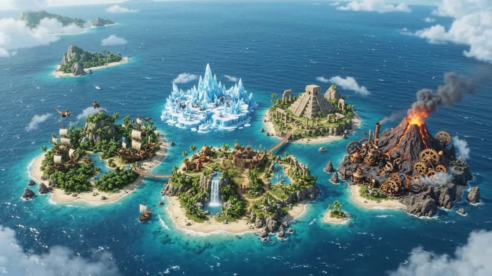

# ИНОЕ — три мира квестов

Интерактивный сайт квест-центра: три самостоятельных мира на общей архитектуре Astro и TypeScript.

**[Открыть сайт](https://doxychis.github.io/quests/)** · [Портфолио автора](https://doxychis.github.io/#projects)

## Три мира

- **ИЗНАНКА** — хоррор, 3D-палата, коридор, аналоговые телевизоры и четыре квеста. Раздел 18+ открывается после подтверждения возраста.
- **АРХИВ** — старая рабочая тетрадь писателя, связный рукописный почерк, чёрно-белые вклейки, пролёт через окно, интерактивные картины и поиск предметов.
- **ОСТРОВ** — семейные экспедиции: «Шёпот джунглей», «Сердце зимы», «Каменный лабиринт», «Дыхание вулкана».



## Версии страниц

Перед первым вступлением экран «Загрузка сцены» ждёт модель, шрифты, компиляцию шейдеров и подготовку первого кадра. Прокрутка на это время заблокирована. Можно пропустить вступление; при ошибке открывается запасная версия с навигацией. Прямые ссылки на разделы и уменьшенное движение обходят экран загрузки.

Главная начинается с чёрного экрана. Прокрутка медленно вводит готовую 3D-руку ладонью к зрителю и раскрывает серебряное слово «ИНОЕ». На фоне движется серебристая пыль, вокруг руки появляется мягкий свет; буквы выходят из расфокуса и ловят узкий блик. Вступление закреплено на нескольких экранах прокрутки, открытая поза задерживается коротко; сглаживание убирает рывки между шагами колеса. Затем тот же логотип по плавной дуге уходит в шапку, рука исчезает, и продолжается страница. Три прежние карточки раскрывают оформление миров боковым сдвигом при наведении и фокусе. В общей оболочке нет декоративных стрелок, номеров и рукописного курсива; используется единое прямое начертание Forum. Выбранная светлая/тёмная тема сохраняется на информационных страницах. [Интеграция руки](docs/HOMEPAGE_HAND.md) · [Фирменное оформление](docs/INOE_BRAND.md).

`/iznanka/` открывает 3D-комнату. Ссылка «Версия без 3D» в шапке ведёт на `/iznanka/information/`: фоновый видеолуп, краткий каталог четырёх квестов, составы команд и правила без пролётов, 3D и декоративных иллюстраций. Обе версии ведут на общие страницы квестов и формы записи.

«О проекте», создание приглашения с предпросмотром и сохранением SVG, а также контакты находятся на главной. Навигация ведёт к `#about`, `#invitations` и `#contacts`. Старые адреса `/about/`, `/certificates/` и `/contacts/` перенаправляют к этим разделам; выбор мира в ссылке сохраняется. Краткие факты о длительности, команде и возрасте заменяют длинное описание. Контакты в `src/lib/config.ts` демонстрационные.

Редактируемый источник комнаты: `assets-source/horror-ward/last-round-ward.blend`, экспорт — `public/models/last-round-ward-v1.glb`. Скрипты Blender — `tools/blender/`.

## Взаимодействия

Серебристый шлейф идёт от ладони в hero до разветвления на три мира. Там он заканчивается, расходясь красной, жёлтой и синей ветвями к карточкам. Его длина следует за прокруткой в обе стороны; поддерживаются мобильная компоновка и уменьшенное движение. [Устройство и проверки потока](docs/HOMEPAGE_ENERGY.md).

Кинематографические проходы связаны с позицией прокрутки: движение прекращается вместе со скроллом и разворачивается при прокрутке назад. В финальной комнате АРХИВА картины открывают краткие истории; на конечном плане ОСТРОВА их открывают светящиеся названия маршрутов. Подробные сюжеты остаются на отдельных страницах. У всех миров есть описания квестов, галереи, мини-игры и демонстрационная запись.

Видео и бесконечные анимации останавливаются вне экрана. Поддерживаются клавиатура, мобильные экраны, системное уменьшение движения и локальные настройки впечатлений. Отдельные фоновые видео первого экрана АРХИВА и ОСТРОВА можно подключить позже через `src/lib/world-media.ts`.

## Запуск

Node.js 24 и npm:

```bash
npm ci
npm run dev
```

Откройте адрес, который напечатает Astro, обычно `http://localhost:4321/`.

```bash
npm run check
npm run build
npm test
```

В проекте 35 статических маршрутов, 12 квестов и 167 функциональных проверок. Трёхмерный хоррор использует Three.js; остальные миры сохраняют свои визуальные системы.

На главной цветная ветвь шлейфа подсвечивает выбранный мир, превью оживают светом, туманом и движением воды. Карточка раскрывается на весь экран при переходе; при возвращении частицы собирают серебряный логотип. Приглашение реагирует на курсор, имя получает эффект тиснения, а сохранение ставит печать ИНОЕ, в том числе в скачанном SVG. Галереи внутри миров не изменены. [Описание эффектов](docs/HOMEPAGE_INTERACTIONS.md).

В 3D-версии «Изнанки» сначала виден обычный коридор. Через секунду после готовности видимой сцены объёмная видеокамера с рукой поднимается к лицу за 1,8 секунды; потусторонний слой и REC включаются у окуляра. Полупрозрачная кнопка ниже центра позволяет снять и снова надеть камеру. Таймер и подъём останавливаются вне экрана и в скрытой вкладке; уменьшенное движение сохраняет секундную задержку, пропуская пространственную анимацию. Модель устройства и траектория редактируются в `src/lib/room-handheld-camera.ts` и `src/lib/room-camera-motion.ts`.

## Структура

- `src/components/` — общие и тематические компоненты.
- `src/lib/data.ts` — сценарии, возраст, длительность и состав команд.
- `src/lib/scroll-cinema.ts` — общая покадровая механика пролётов.
- `src/styles/` — независимые визуальные системы миров.
- `public/assets/`, `public/fonts/` — локальные изображения, видео и шрифты.
- `tests/` — логика игр, взаимодействия и проверка сборки.

## Публикация и материалы

[Инструкция публикации](docs/PUBLISHING.md). Готовая версия размещена в папке `/quests/` действующего сайта-портфолио. GitHub Actions проверяет исходники и сохраняет сборку для этого адреса.

[Рабочая тетрадь АРХИВА](docs/ARCHIVE_NOTEBOOK.md) · [Отчёт по АРХИВУ и ОСТРОВУ](docs/ARCHIVE_ISLAND_REPORT.md) · [Два промпта для будущих хиро-видео](docs/HERO_VIDEO_PROMPTS_RU.md) · [Источники и лицензии материалов](ASSET_CREDITS.md).

Это демонстрационный проект. Сценарии вымышлены, реальные цены и контакты площадки не подключены. Форма записи показывает локальное подтверждение и не отправляет данные. Сгенерированные иллюстрации обозначают художественные образы, а не фотографии действующих квестов.
